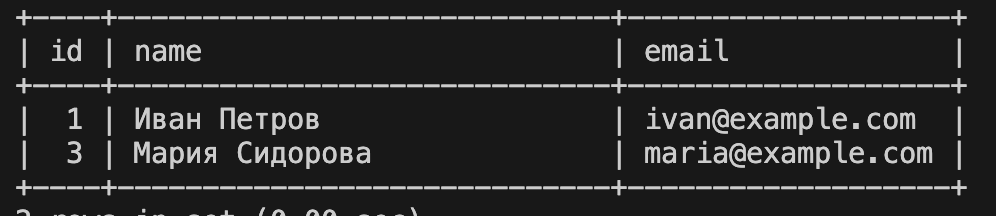
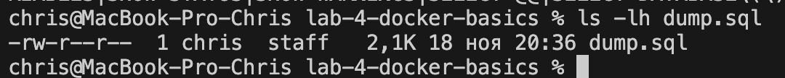

# 🗄️ Отчёт: Интерактивная работа с MySQL в Docker №1


> **Дисциплина:** Основы проектирования баз данных
> **Задание:** Запуск чистого контейнера, базовые операции с БД, создание дампа и выгрузка лога.
> **Дата:** ноябрь 2026

---

## 📑 Содержание

1. [Цель работы](#-цель-работы)
2. [Среда выполнения](#-среда-выполнения)
3. [Структура проекта](#-структура-проекта)
4. [Ход выполнения](#-ход-выполнения)
   - [Шаг 1. Запуск контейнера](#шаг-1-запуск-контейнера)
   - [Шаг 2. Подключение и создание БД](#шаг-2-подключение-и-создание-бд)
   - [Шаг 3. Базовые операции (CRUD)](#шаг-3-базовые-операции-crud)
   - [Шаг 4. Создание дампа и выгрузка лога](#шаг-4-создание-дампа-и-выгрузка-лога)
5. [Вывод](#-вывод)

---

## 🎯 Цель работы

Научиться запускать «чистый» контейнер MySQL в Docker, подключаться к нему, выполнять основные операции с базами данных и таблицами (создание, вставка, обновление, удаление), а также освоить создание дампа базы данных и выгрузку системного лога.

---

## 🛠 Среда выполнения

| Компонент | Версия / Значение |
|-----------|-------------------|
| ОС | macOS (Apple Silicon) |
| Терминал | zsh |
| Docker | Docker Desktop |
| Образ MySQL | `mysql:8.0` → **MySQL Community Server 8.0.46** |
| Кодировка | `utf8mb4` / `utf8mb4_unicode_ci` |
| Логирование | `general_log = 1`, `log_output = FILE` |

---

## 📁 Структура проекта

```text
lab-4-docker-basics/
├── 📄 my.cnf          # конфиг MySQL (utf8mb4 + general_log = FILE)
├── 💾 dump.sql        # дамп БД my_database
├── 📝 my_actions.log  # отфильтрованный лог действий
├── 📘 README.md       # этот отчёт
└── 📸 screenshots/
    ├── 01-db-users.png
    └── 02-dump-log.png
```

---

## 🚀 Ход выполнения

### Шаг 1. Запуск контейнера

Создан файл `my.cnf` с настройками кодировки и логированием в файл:

```ini
[mysqld]
character-set-server = utf8mb4
collation-server = utf8mb4_unicode_ci
general_log = 1
general_log_file = /var/lib/mysql/general.log
log_output = FILE

[client]
default-character-set = utf8mb4

[mysql]
default-character-set = utf8mb4
```

Запуск чистого контейнера (с предварительным удалением старых томов):

```bash
docker rm -f my-mysql
docker volume rm mysql_data

docker run --name my-mysql \
  -e MYSQL_ROOT_PASSWORD=123 \
  -e LANG=C.UTF-8 \
  -v mysql_data:/var/lib/mysql \
  -v "$(pwd)/my.cnf:/etc/mysql/conf.d/my.cnf" \
  -d mysql:8.0
```

Подключение к контейнеру:

```bash
docker exec -it my-mysql mysql --default-character-set=utf8mb4 -uroot -p
```
*(Пароль: `123`)*

---

### Шаг 2. Подключение и создание БД

Внутри консоли MySQL создана база данных `my_database` и таблица `users`:

```sql
CREATE DATABASE my_database
  CHARACTER SET utf8mb4
  COLLATE utf8mb4_unicode_ci;
USE my_database;

CREATE TABLE users (
    id INT AUTO_INCREMENT PRIMARY KEY,
    name VARCHAR(100) NOT NULL,
    email VARCHAR(100) NOT NULL UNIQUE
) CHARACTER SET utf8mb4 COLLATE utf8mb4_unicode_ci;
```

---

### Шаг 3. Базовые операции (CRUD)

Выполнены основные операции манипулирования данными:

**Вставка (Create):**
```sql
INSERT INTO users (name, email) VALUES
  ('Иван Иванов', 'ivan@example.com'),
  ('Пётр Петров', 'petr@example.com'),
  ('Мария Сидорова', 'maria@example.com');
```

**Обновление (Update):**
```sql
UPDATE users SET name = 'Иван Петров' WHERE id = 1;
```

**Удаление (Delete):**
```sql
DELETE FROM users WHERE id = 2;
```

**Чтение (Read):**
```sql
SELECT * FROM users;
```



---

### Шаг 4. Создание дампа и выгрузка лога

Выйдя из MySQL (`\q`), был создан «чистый» дамп базы данных:

```bash
docker exec -e MYSQL_PWD=123 my-mysql mysqldump -uroot \
  --set-gtid-purged=OFF \
  --single-transaction \
  my_database > dump.sql
```

Затем системный лог `general.log` был отфильтрован от служебного шума (команд `SET`, `SHOW` и т.д.) и сохранён в файл:

```bash
docker exec my-mysql cat /var/lib/mysql/general.log \
  | grep "Query" \
  | grep -v -E "SET NAMES|SET autocommit|SET sql_mode|SET character_set_results|SHOW VARIABLES|SHOW STATUS|SHOW WARNINGS|SELECT @@|SELECT DATABASE\(\)|time_zone" \
  > my_actions.log
```



---

## ✅ Вывод

В ходе выполнения работы:

1. ✅ Освоен запуск «чистого» контейнера MySQL с монтированием конфигурационного файла `my.cnf`.
2. ✅ Изучены базовые операции CRUD (создание таблицы, вставка, обновление и удаление записей).
3. ✅ Создан согласованный дамп базы данных без использования GTID (`--set-gtid-purged=OFF`).
4. ✅ Получен и отфильтрован системный лог действий, содержащий только осмысленные SQL-команды.

---

## 📎 Приложения

- 📄 [Лог действий](my_actions.log)
- 💾 [Дамп БД `my_database`](dump.sql)
- ⚙️ [Конфиг MySQL](my.cnf)

---

<div align="center">
  <i>© 2026</i>
</div>
